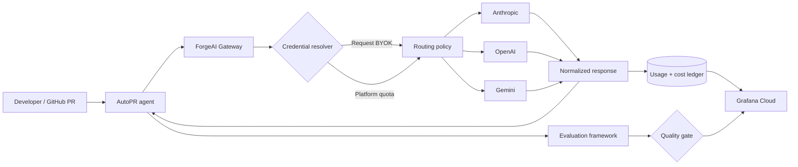
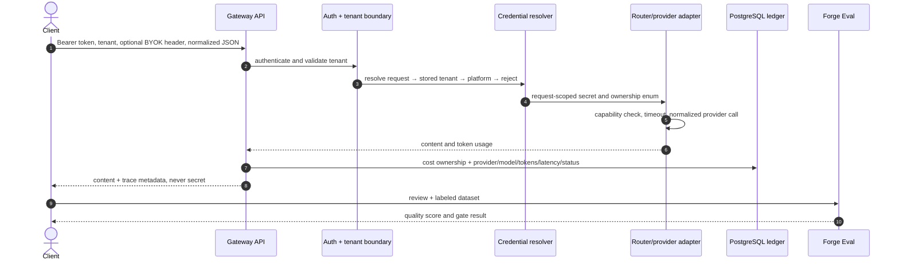

# ForgeAI

### Reliable LLM orchestration, autonomous code review, and continuous AI evaluation

[](.github/workflows/ci.yml) [](SECURITY.md) [](gateway) [](autopr)

ForgeAI is a production-oriented AI engineering platform. Its core is a multi-provider Gateway that owns tenant identity, request-scoped BYOK credentials, routing, normalized provider calls, usage attribution, and operational telemetry. AutoPR consumes only that Gateway, then the reusable evaluation package measures whether its reviews are actually useful.

> **Readiness statement:** the repository is a deployable vertical slice, not a claim that an unoperated demo is production-certified. Session-only BYOK, provider adapters, durable ledger, webhook validation, deterministic quality gates, hardened containers, CI/security scans, metrics, alerts, and runbooks are implemented. Distributed quotas, exact/semantic cache, encrypted account credentials, full fallback policy, prompt experiments, and calibrated LLM judging remain explicitly staged work.

## The engineering story



For any request, the system is designed to answer: who paid, which model handled it, why it was selected, how long it took, what it cost, whether fallback/cache was involved, and—when it produced a review—how well that review matched an evaluation set.

## Capabilities

| Area | Implemented now | Production evolution |
|---|---|---|
| Gateway | Provider-neutral API, OpenAI/Anthropic/Gemini adapters, BYOK priority, capability routing, durable ledger | Redis distributed quotas, measured fallback, SSE, cancellation |
| BYOK | `X-Provider-Key`, request scope, memory zeroing, no persistence/logging/response | KMS envelope encryption only if stored credentials become necessary |
| AutoPR | GitHub HMAC verification, diff ingestion, deterministic signals, structured review, review posting | Queue-backed jobs, check-runs, bounded repository tools |
| Evaluation | Importable package, CLI, precision/recall/severity/critical-miss scoring, failing quality gate | Human-calibrated judge ensemble, experiment statistics |
| Operations | Prometheus endpoints/rules, correlation IDs, health probes, hardened containers, runbook | Grafana Cloud remote-write, managed SLOs, tracing collector |
| Delivery | Tests/lint, Compose validation, Trivy scan, signed-build provenance/SBOM, immutable image tags | Cloud-specific OIDC deployment adapter and progressive rollout |

## Quick start

Requirements: Docker Desktop with Compose. Provider-owned keys are optional because the system works in BYOK-only mode.

```bash
cp .env.example .env
# Set POSTGRES_PASSWORD, GITHUB_WEBHOOK_SECRET, and FORGEAI_INTERNAL_TOKEN.
docker compose up --build
```

| Endpoint | Address | Purpose |
|---|---|---|
| Dashboard | http://localhost:3000 | Polished operational control-plane preview |
| Gateway health | http://localhost:8080/actuator/health | Liveness/readiness and dependency state |
| Gateway metrics | http://localhost:8080/actuator/prometheus | Prometheus-compatible telemetry |
| AutoPR health | http://localhost:8000/healthz | Service health |
| AutoPR webhook | `POST http://localhost:8000/webhooks/github` | Signed GitHub events |

Make a BYOK request (the secret stays in a dedicated header and never enters the JSON model):

```bash
curl http://localhost:8080/v1/generate \
  -H 'Authorization: Bearer <FORGEAI_INTERNAL_TOKEN>' \
  -H 'X-Tenant-Id: developer-demo' \
  -H 'X-Provider-Key: <YOUR_PROVIDER_KEY>' \
  -H 'Content-Type: application/json' \
  -d '{"provider":"OPENAI","model":"gpt-4o-mini","routingMode":"EXPLICIT","messages":[{"role":"user","content":"Explain circuit breakers in one paragraph."}]}'
```

Run the deterministic evaluation gate:

```bash
pip install -e './eval-framework[dev]'
forge-eval run eval-framework/datasets/smoke.json --minimum-score 0.90
```

## Repository map

| Path | Responsibility |
|---|---|
| [`gateway`](gateway) | Java 21/Spring Boot orchestration core and PostgreSQL ledger |
| [`autopr`](autopr) | FastAPI GitHub application and review agent |
| [`eval-framework`](eval-framework) | Reusable Python evaluator and CLI |
| [`dashboard`](dashboard) | Responsive, security-header-hardened control-plane UI |
| [`monitoring`](monitoring) | Prometheus scrape config and actionable SLO alerts |
| [`docs/architecture`](docs/architecture) | C4, DFDs, request lifecycle, trade-offs |
| [`docs/adr`](docs/adr) | Required decision register |
| [`docs/runbooks`](docs/runbooks) | Incident and recovery procedures |

## Request and data lifecycle



The schema intentionally separates identity from request accounting:

| Entity | Sensitive? | Retention role |
|---|---:|---|
| `tenant` | Identifier only | Isolation, quota, ownership |
| `llm_request` | Metadata; no prompt/key | Authoritative tokens, estimated cost, route, status |
| Redis rate/cache keys | Tenant-scoped | TTL-bound operational state; never BYOK secrets |
| Provider key | **Secret** | Request memory only; discarded after completion |

Detailed C4 and level-0/level-1 DFDs are in [architecture.md](docs/architecture/architecture.md). The STRIDE-oriented control table is in [threat-model.md](docs/security/threat-model.md).

## CI/CD, containers, and monitoring

Pull requests compile and test Java, lint/test both Python packages, and validate Compose. The security workflow blocks high/critical filesystem findings. SemVer tags build non-root images, attach build provenance and SBOMs, and push immutable SHA/version tags to GHCR. The protected `production` environment is deliberately a deployment adapter: connect it to a chosen managed platform with OIDC rather than committing long-lived cloud credentials.

All application containers run as non-root with read-only filesystems and `no-new-privileges`; state is isolated in PostgreSQL/Redis volumes. Compose health gates dependency startup. For local observability:

```bash
docker compose -f docker-compose.yml -f monitoring/docker-compose.monitoring.yml up --build
```

Production sends the same low-cardinality Micrometer/Prometheus series to Grafana Cloud. Alerts cover provider error ratio, p95 latency, and failed reviews. Metrics never label by tenant, request, prompt, key, or PR diff. Logs carry correlation IDs but exclude headers and bodies. See the [provider outage runbook](docs/runbooks/provider-outage.md).

## Quality and security gates

- Unit tests validate secret priority/zeroing, GitHub signature comparison, and deterministic evaluation penalties.
- Provider traffic is mocked in tests; real keys must never enter CI.
- Database/Redis Testcontainers and cross-tenant cache tests are required before enabling the proposed cache/rate-limit modules.
- Review quality promotion requires a representative labeled set, zero critical misses, stable precision/recall, and human review—not one judge score.
- Release readiness also requires load testing under provider latency and 429/5xx injection. The likely first 10× bottleneck is synchronous ledger writes; batch/outbox persistence is the measured next step, not premature Kafka.

## Delivery roadmap

1. **MVP (this repository):** BYOK Gateway vertical slice, three adapters, ledger, AutoPR workflow, deterministic evaluation, hardened Compose, CI/security/release scaffolding.
2. **Production-oriented:** Redis token-bucket limits, exact tenant cache, Resilience4j fallback matrix, Testcontainers contracts, OpenTelemetry traces, queue-backed webhook jobs, managed backing services.
3. **Advanced:** prompt registry/experiments, SSE, encrypted account credentials with KMS, semantic caching with leakage/false-match tests.
4. **R&D:** adaptive quality/cost routing, agent-vs-single-pass benchmarks, calibrated LLM judges, trajectory evaluation.

## Interview narrative

“I built the infrastructure around AI applications: a tenant-aware multi-provider Gateway with BYOK economics and auditable cost ownership; an autonomous PR reviewer that cannot bypass that control plane; and an evaluation package that turns AI quality into a repeatable CI signal. I kept secrets out of payloads, logs, caches, and ledgers, documented failure boundaries, and resisted Kafka/Kubernetes/vector databases until measurements justify them.”

## License

[MIT](LICENSE). Provider API use and GitHub installation remain subject to their respective terms and billing.
