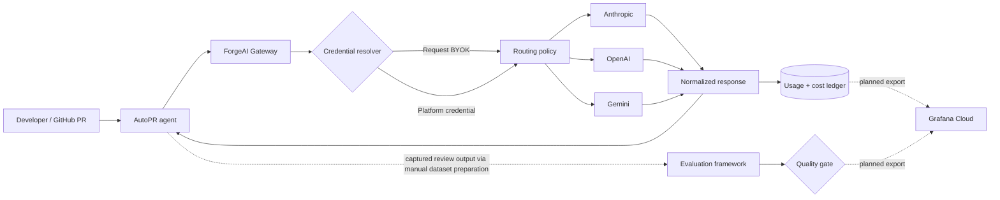
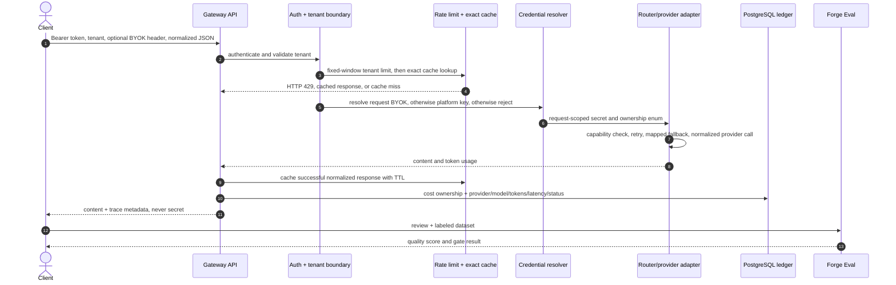

# ForgeAI

### Reliable LLM orchestration, Gateway-bound code review, and continuous AI evaluation

[](.github/workflows/ci.yml) [](SECURITY.md) [](gateway) [](autopr)

ForgeAI is a production-oriented AI engineering platform. Its core is a multi-provider Gateway that owns tenant identity, request-scoped BYOK credentials, routing, normalized provider calls, usage attribution, and operational telemetry. AutoPR is implemented to consume only that Gateway, then the reusable evaluation package measures review quality.

> **Readiness statement:** this is a deployable vertical slice, not a production-certification claim. Local verification covers adapter contracts, request-scoped BYOK handling with non-production keys, PostgreSQL usage entries, retry and mapped cross-provider fallback, tenant-private exact caching, per-tenant fixed-window limits, webhook signature rejection, deterministic evaluation, SPDX image SBOMs, SLSA provenance attestations, immutable local image references, and syntax-checked provisional alerts. Real commercial-provider calls, a real GitHub review, live-review evaluation, hosted access-log/APM redaction, and execution of the GitHub release workflow remain unverified until credentials and external test infrastructure are supplied.

## The engineering story



For successful requests, the ledger records credential ownership, provider/model, token counts, estimated cost, latency, cache use, and fallback use. It does not yet persist a detailed routing-decision explanation or failed provider attempts.

## Capabilities

| Area | Implemented now | Production evolution |
|---|---|---|
| Gateway | Provider-neutral API; three contract-tested adapters; BYOK/platform resolution; retry; configured cross-provider model fallback; tenant-private exact cache; per-tenant fixed-window limit; durable success ledger | Live-provider certification, failed-attempt ledger entries, distributed load tests, SSE, cancellation |
| BYOK | `X-Provider-Key`, request scope, memory zeroing, no application-log/API/metric leakage in local tests | Hosting access-log/APM verification; KMS envelope encryption only if stored credentials become necessary |
| AutoPR | GitHub HMAC verification, diff ingestion, deterministic signals, structured review generation, simulated review posting | Real GitHub App/repository verification, inline comments, queue-backed jobs, check-runs |
| Evaluation | Importable package and CLI with deterministic precision/recall/severity/critical-miss gates, verified on synthetic datasets | Evaluation of a live AutoPR review, human-calibrated judge ensemble, experiment statistics |
| Operations | Prometheus endpoints/rules, correlation IDs, health probes, hardened Compose containers, observed-failure runbook, and measured provisional objectives | Hosted remote-write, alert delivery, production SLO calibration, traces, and broader failure exercises |
| Delivery | CI/security/release workflow definitions, local test/lint and Compose verification, generated image SBOM/provenance files, commit tags, and immutable digests | GitHub-hosted workflow execution, cloud OIDC deployment adapter, smoke/rollback proof |

## Quick start

Requirements: Docker Desktop with Compose. Platform-funded provider keys are optional; an inference request still requires either `X-Provider-Key` BYOK or the corresponding configured platform key.

```bash
cp .env.example .env
# Set POSTGRES_PASSWORD, GITHUB_WEBHOOK_SECRET, and FORGEAI_INTERNAL_TOKEN.
docker compose up --build
```

| Endpoint | Address | Purpose |
|---|---|---|
| Dashboard | http://localhost:3000 | Polished operational control-plane preview |
| Gateway health | http://localhost:8080/actuator/health | Liveness/readiness and dependency state |
| Gateway metrics | http://localhost:8080/actuator/prometheus | Prometheus-compatible telemetry |
| AutoPR health | http://localhost:8000/healthz | Service health |
| AutoPR webhook | `POST http://localhost:8000/webhooks/github` | Signed GitHub events |

Make a BYOK request (the secret stays in a dedicated header and never enters the JSON model):

```bash
curl http://localhost:8080/v1/generate \
  -H 'Authorization: Bearer <FORGEAI_INTERNAL_TOKEN>' \
  -H 'X-Tenant-Id: developer-demo' \
  -H 'X-Provider-Key: <YOUR_PROVIDER_KEY>' \
  -H 'Content-Type: application/json' \
  -d '{"provider":"OPENAI","model":"gpt-4o-mini","routingMode":"EXPLICIT","messages":[{"role":"user","content":"Explain circuit breakers in one paragraph."}]}'
```

Run the deterministic evaluation gate:

```bash
pip install -e './eval-framework[dev]'
forge-eval run eval-framework/datasets/smoke.json --minimum-score 0.90
```

## Repository map

| Path | Responsibility |
|---|---|
| [`gateway`](gateway) | Java 21/Spring Boot orchestration core and PostgreSQL ledger |
| [`autopr`](autopr) | FastAPI GitHub application and review agent |
| [`eval-framework`](eval-framework) | Reusable Python evaluator and CLI |
| [`dashboard`](dashboard) | Responsive, security-header-hardened control-plane UI |
| [`monitoring`](monitoring) | Prometheus scrape config and provisional, syntax-checked alert rules |
| [`docs/architecture`](docs/architecture) | C4, DFDs, request lifecycle, trade-offs |
| [`docs/adr`](docs/adr) | Required decision register |
| [`docs/runbooks`](docs/runbooks) | Procedures for observed failures plus explicit untested-mode boundaries |
| [`docs/operations`](docs/operations) | Measurement-derived provisional objectives and calibration limits |
| [`verification/release`](verification/release) | Reproducible local SBOM, provenance, and immutable-image manifest generation |

## Request and data lifecycle



The schema intentionally separates identity from request accounting:

| Entity | Sensitive? | Retention role |
|---|---:|---|
| `tenant` | Identifier only | Isolation, quota, ownership |
| `llm_request` | Metadata; no prompt/key | Authoritative tokens, estimated cost, route, status |
| Redis rate/cache keys | Tenant-scoped | TTL-bound operational state; never BYOK secrets |
| Provider key | **Secret** | Request memory only; discarded after completion |

Detailed C4 and level-0/level-1 DFDs are in [architecture.md](docs/architecture/architecture.md). The STRIDE-oriented control table is in [threat-model.md](docs/security/threat-model.md).

## CI/CD, containers, and monitoring

The checked-in workflows are configured so pull requests compile/test Java, lint/test both Python packages, validate Compose configuration, and scan the filesystem with Trivy. The tag workflow is configured to build non-root images, request provenance/SBOM attestations, and publish immutable tags to GHCR. Local release verification uses `verification/release/build-artifacts.ps1` to emit SPDX SBOMs, in-toto/SLSA provenance, BuildKit metadata, commit-tagged images, and digest-pinned references under the ignored `verification/artifacts` directory. These GitHub workflow definitions have not been executed because no remote is configured. The `production` job remains an explicit deployment-adapter placeholder.

```powershell
powershell -NoProfile -ExecutionPolicy Bypass -File verification/release/build-artifacts.ps1
```

All application containers run as non-root with read-only filesystems and `no-new-privileges`; state is isolated in PostgreSQL/Redis volumes. Compose health gates dependency startup. For local observability:

```bash
docker compose -f docker-compose.yml -f monitoring/docker-compose.monitoring.yml up --build
```

Local services expose low-cardinality Micrometer/Prometheus series. Syntax-checked alert rules cover provider errors, the measured provisional 375 ms Gateway p95, a 60% exact-repeat cache rate, and failed reviews. No Grafana Cloud remote-write or alert delivery was verified. Application metrics avoid tenant, request, prompt, key, and PR-diff labels; local application logs were scanned for test credentials with zero matches. Hosting-platform access logs and external APM remain unverified. The incident runbook is limited to the exercised 503/fallback, tenant 429, and unsigned-webhook 401 paths; other failure modes are explicitly marked untested. See the [provisional objectives](docs/operations/slo.md).

## Quality and security gates

- Unit tests validate secret priority/zeroing, GitHub signature comparison, and deterministic evaluation penalties.
- Provider traffic is mocked in tests; real keys must never enter CI.
- Redis cache and rate-limit units are enabled. Unit tests validate hashed tenant/provider identities, and Compose runtime checks validate cross-tenant cache isolation. Java Testcontainers could not connect to this Windows Docker named pipe and is not claimed as passing.
- Review quality promotion requires a representative labeled set, zero critical misses, stable precision/recall, and human review—not one judge score.
- Release readiness also requires load testing under provider latency and 429/5xx injection. The likely first 10× bottleneck is synchronous ledger writes; batch/outbox persistence is the measured next step, not premature Kafka.

## Delivery roadmap

1. **MVP (this repository):** BYOK Gateway vertical slice, three adapters, ledger, AutoPR workflow, deterministic evaluation, hardened Compose, CI/security/release scaffolding.
2. **Production-oriented:** distributed quota/load validation, circuit-breaker calibration, Testcontainers or equivalent CI integration contracts, OpenTelemetry traces, queue-backed webhook jobs, managed backing services.
3. **Advanced:** prompt registry/experiments, SSE, encrypted account credentials with KMS, semantic caching with leakage/false-match tests.
4. **R&D:** adaptive quality/cost routing, agent-vs-single-pass benchmarks, calibrated LLM judges, trajectory evaluation.

## Interview narrative

“I built the infrastructure around AI applications: a tenant-aware multi-provider Gateway with BYOK economics and auditable cost ownership; a PR-review workflow designed to use that control plane; and an evaluation package that turns AI quality into a repeatable CI signal. Local tests prove the control boundaries; live provider and GitHub certification are the next external verification gates.”

## License

[MIT](LICENSE). Provider API use and GitHub installation remain subject to their respective terms and billing.
