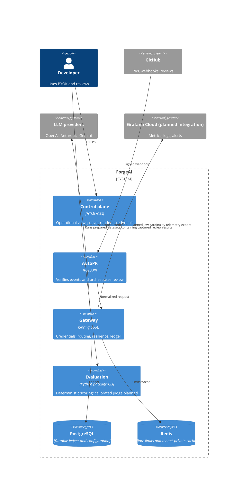
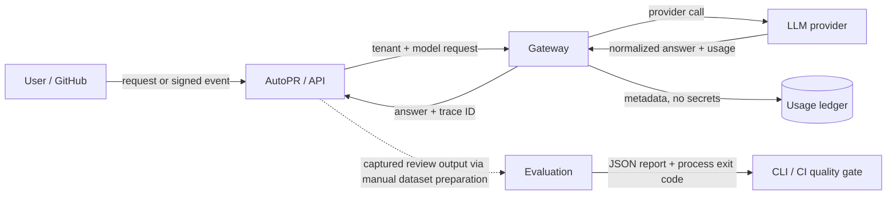

# Architecture and data flows

## C4 — containers



## DFD level 0



## DFD level 1 — credential resolution and inference

```mermaid
sequenceDiagram
  participant C as Client
  participant G as Gateway
  participant R as Credential resolver
  participant Q as Rate limit/cache
  participant P as Provider adapter
  participant D as Ledger
  C->>G: JSON + X-Tenant-Id + optional X-Provider-Key
  G->>Q: increment fixed-window counter for tenant
  alt limit exceeded
    Q-->>G: reject
    G-->>C: HTTP 429; no ledger row
  else allowed
    Q-->>G: allow
    G->>Q: exact lookup(tenant, selected provider, request)
    alt cache hit
      Q-->>G: cached normalized result
      G->>D: zero-cost cache-hit ledger row
      G-->>C: cached result + trace
    else cache miss
      Q-->>G: miss
      G->>R: request BYOK, otherwise platform key, otherwise reject
      R-->>G: request-scoped char[] + ownership
      G->>P: normalized request + credential; retry transient failure
      P-->>G: failure may trigger configured mapped fallback
      G->>P: fallback model + platform credential when eligible
      P-->>G: normalized result/usage
      G->>Q: cache successful normalized result with TTL
      G->>D: ownership, tokens, latency, route, status
      G-->>C: result + trace, never credential
      G->>G: zero request credential buffer
    end
  end
```

## Key decisions

| Decision | Why | Trade-off / revisit trigger |
|---|---|---|
| Monorepo | Atomic contracts and CI; easier portfolio operation | Split when teams release independently |
| Session BYOK | Smallest secret-retention surface | Add envelope-encrypted account keys only with KMS and product need |
| REST + non-streaming MVP | Clear retry and ledger semantics | Add SSE when interactive token latency is measured as material |
| PostgreSQL ledger | Durable, queryable cost ownership | Buffer writes only when measured write latency dominates |
| Redis, no Kafka | Rate/cache needs without operational excess | Add event bus when durable async consumers and replay exist |
| Deterministic eval first | Reproducible CLI/CI gate | Blend calibrated judges after human-labeled validation |
| Direct GitHub API | Narrow tool attack surface | Add MCP when multiple interchangeable tool hosts create value |

Exact caching is enabled with a configurable TTL. Tenant, selected provider, and the canonical normalized request are hashed into the Redis identity; credentials are never cache inputs or values. Unit tests and a local Compose runtime check cover cross-tenant isolation. Semantic caching remains intentionally unimplemented.
